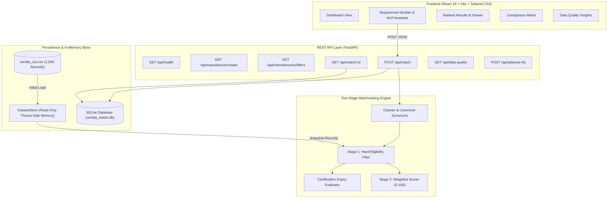

# VERIDIA MATCH

> **"Finding the right manufacturing partner, intelligently."**

[](https://www.python.org/)
[](https://fastapi.tiangolo.com/)
[](https://react.dev/)
[](https://tailwindcss.com/)
[](https://www.sqlite.org/)
[-emerald.svg)](https://docs.python.org/3/library/unittest.html)

VERIDIA MATCH is an enterprise B2B precision engineering matchmaking platform connecting international buyers with audited precision manufacturers across India. Built for rigorous industrial procurement, it replaces subjective matching and black-box recommendations with deterministic two-stage qualification, mathematical compatibility scoring, and transparent explanations.

---

## 1. Problem Statement & Business Context

International procurement leaders sourcing custom precision components from India face three critical challenges:

1. **Information Asymmetry & Over-claiming:** Suppliers frequently claim capabilities they cannot reliably execute, resulting in delayed lead times or batch rejections.
2. **Certification Expiry Vulnerability:** Regulated industries (Aerospace AS9100, Automotive IATF 16949, Medical ISO 13485) require certifications to be audited and valid on a specific evaluation date, not assumed valid indefinitely.
3. **Data Quality & Inconsistent Cataloguing:** Real-world supplier records contain missing lead times, ID collisions, and unverified export capabilities. Treating missing values as satisfied leads to catastrophic supply-chain failure.

**Veridia Match** solves this through a robust two-stage engine:
- **Stage 1: Hard Eligibility Filtering** (Strict zero-hallucination qualification)
- **Stage 2: Transparent Multi-Factor Weighted Scoring** (Explainable compatibility ranking)

---

## 2. Core Features

### 🏢 Network Dashboard
- High-level KPIs: 1,000 Total Suppliers, Verified Certifications, Complete Records (98.0%), and Cluster Geography (16 Cities across 10 States).
- Interactive Capability Distribution for 9 Manufacturing Processes and 9 Engineering Raw Materials.
- Persistent recent request history with one-click result reload.

### ⚙️ Precision Requirement Builder
- Form fields dynamically populated from dataset values (Materials, Processes, Volumes, Certifications, Deadlines, Destination Countries).
- Deterministic Evaluation Date picker ensuring historical/future certification audit integrity.
- **AI RFQ Assistant:** Rule-based NLP extractor that converts conversational buyer requirements into structured form inputs without external API dependencies.
- One-click Test Presets: **Buyer A (Aluminium CNC)** and **Buyer B (Stainless Steel Sheet Metal)**.

### 🎯 Ranked Matching Results
- Funnel metrics: Total Scanned, Hard Eligible, Needs Verification, and Disqualified.
- Ranked supplier cards with compatibility scores (out of 100).
- Transparent eligibility status pills: `ELIGIBLE` vs `NEEDS_VERIFICATION`.
- Itemized score breakdown (Delivery 35%, Capacity 30%, Certification 20%, Track Record 15%).
- Bulleted "Why Qualified" explanations and explicit warnings regarding export clearance or unrecorded fields.
- Fast sorting (Highest Score, Fastest Lead Time, Largest Capacity) and real-time search.

### ⚖️ Side-by-Side Manufacturer Matrix
- Compare up to 3 selected manufacturers across technical parameters: lead times, capacity utilization, order bounds (MOQ/Max), materials, processes, audit dates, and direct contact.

### 🛡️ Data Quality & Governance Insights
- Deep audit report identifying real anomalies in `veridia_csv.csv`:
  - **10 ID Number Collisions (20 Records):** Preserves distinct entity profiles via deterministic composite keys.
  - **10 Missing Lead Times (1.0%):** Flags status as `NEEDS_VERIFICATION` rather than falsely disqualifying or blindly accepting.
  - **10 Out-of-Bounds OTD Metric Records (>100%):** Clamps to 100.0% for ranking and attaches explicit audit warnings.

---

## 3. System Architecture



---

## 4. Matching Algorithm & Scoring Model

### Stage 1: Hard Eligibility Filtering
Every supplier is evaluated against mandatory buyer criteria. No probabilistic guesses are permitted.

| Criteria | Hard Evaluation Rule | Policy if Data Missing |
|---|---|---|
| **Material** | Normalized buyer material $\in$ supplier materials | Immediate Disqualification (`INELIGIBLE`) |
| **Process** | Target process hierarchy $\cap$ supplier processes $\neq \emptyset$ | Immediate Disqualification (`INELIGIBLE`) |
| **Certification** | Manufacturer holds standard AND `issue_date` $\le$ `evaluation_date` $\le$ `expiry_date` | Missing expiry $\rightarrow$ `NEEDS_VERIFICATION`. Expired $\rightarrow$ `INELIGIBLE`. |
| **Volume / Capacity** | `quantity` $\le$ `capacity_units_per_month` | Exceeds capacity $\rightarrow$ `INELIGIBLE`. |
| **Delivery Deadline** | `lead_time_days` $\le$ `delivery_deadline_days` | Missing lead time $\rightarrow$ `NEEDS_VERIFICATION`. |

A candidate receives status:
- **`ELIGIBLE`**: All mandatory criteria verified and satisfied.
- **`NEEDS_VERIFICATION`**: Technical capabilities match, but critical attributes (e.g., lead time) require manual supplier confirmation.
- **`INELIGIBLE`**: Fails one or more hard requirements.

---

### Stage 2: Transparent Weighted Ranking
Qualified suppliers are scored on a normalized 0 to 100 scale:

$$\text{Total Score} = S_{\text{delivery}} + S_{\text{capacity}} + S_{\text{cert}} + S_{\text{track}}$$

1. **Delivery Suitability ($S_{\text{delivery}}$, 35 pts):**
   - If lead time missing: baseline 15.0 pts with caveat.
   - If $\text{lead\_time} \le \text{deadline}$: Score $= 20.0 + \left(\frac{\text{deadline} - \text{lead\_time}}{\text{deadline}} \times 15.0\right)$.
2. **Capacity Suitability ($S_{\text{capacity}}$, 30 pts):**
   - Headroom utilization: $\text{order\_pct} = \frac{\text{quantity}}{\text{capacity}}$. Optimal window (10%–60%) awards 26–30 pts.
   - Batch alignment bonus: $+3$ pts if $\text{MOQ} \le \text{quantity} \le \text{Max Order}$; penalties for out-of-bound batches.
3. **Certification Quality ($S_{\text{cert}}$, 20 pts):**
   - Verified valid required certification: 16.0 pts ($+4.0$ bonus for dual certifications like AS9100 / IATF 16949).
   - If no certification mandated: 13–18 pts awarded based on quality portfolio depth.
4. **Track Record & Export Readiness ($S_{\text{track}}$, 15 pts):**
   - Clamped On-Time Delivery Rate: $\frac{\min(100, \text{OTD})}{100} \times 8.0$ pts.
   - Export Experience: $\min(7.0, \frac{\text{years}}{25} \times 7.0)$ pts.

---

## 5. Dataset Profiling & Handling

The dataset (`veridia_csv.csv`) contains 1,000 rows across 31 attributes. Our profiling revealed three critical anomalies:

1. **Duplicate Manufacturer IDs (10 Collision Keys across 20 Records):**
   - IDs like `VM1092` belong to two different companies (e.g. *Narmada Titan Machine Works* in Ahmedabad vs *Deccan Crest Castings Pvt Ltd* in Aurangabad).
   - **Resolution:** Raw IDs are preserved for client traceability while assigning unique internal `record_id` hashes. Both companies remain fully matchable.
2. **Missing Turnaround Times (10 Records / 1.0%):**
   - IDs `VM1150`, `VM1281`, `VM1438`, etc. lack `lead_time_days`.
   - **Resolution:** Assigned `NEEDS_VERIFICATION` status when a delivery deadline is required.
3. **Out-of-Bounds OTD Metric (10 Records > 100%):**
   - Values up to 142.6% are recorded.
   - **Resolution:** Clamped to 100.0% during scoring and explicitly documented in audit warnings.
4. **Destination Country Limitations:**
   - All suppliers operate in India. The dataset lacks country-specific customs tariffs or shipping lane transit schedules.
   - **Resolution:** The platform verifies origin export experience, documents the limitation, and issues a transparent export compliance warning.

---

## 6. Installation & Setup

### Prerequisites
- Python 3.10+
- Node.js 18+ and npm

### 1. Backend Setup
```bash
# From workspace root
# Verify Python version
python --version

# Run the test suite to verify matching engine integrity
python run_tests.py

# Start FastAPI backend server
python -m uvicorn backend.app.main:app --host 127.0.0.1 --port 8000 --reload
```
The backend API is now running at `http://127.0.0.1:8000` with Swagger docs at `http://127.0.0.1:8000/docs`.

### 2. Frontend Setup
```bash
# Navigate to frontend
cd frontend

# Install dependencies
npm install

# Start development server
npm run dev
```
The React frontend is accessible at `http://localhost:5173`.

### 3. Unified Production Mode
The React application has already been pre-compiled into `frontend/dist`. Running the FastAPI server directly serves both the REST API and the complete Single Page Application from `http://127.0.0.1:8000/`.

---

## 7. REST API Documentation

### `POST /api/match`
Executes isolated two-stage matching for a buyer requirement.

**Sample Request:**
```json
{
  "material": "Aluminium",
  "process": "CNC machining",
  "quantity": 1000,
  "certification": "ISO 9001",
  "delivery_deadline_days": 42,
  "destination_country": "United States",
  "evaluation_date": "2026-11-12"
}
```

**Sample Response:**
```json
{
  "request_id": "bc4f11f6-...",
  "created_at": "2026-11-12T00:17:43.195000",
  "evaluation_date": "2026-11-12",
  "total_scanned": 1000,
  "total_eligible": 33,
  "total_needs_verification": 0,
  "total_ineligible": 967,
  "results": [
    {
      "record_id": "VM1938_rec_937",
      "manufacturer_id": "VM1938",
      "name": "Krishna Crest Metal Works",
      "city": "Faridabad",
      "state_name": "Haryana",
      "status": "ELIGIBLE",
      "match_score": 88.9,
      "score_breakdown": {
        "delivery_suitability": 30.0,
        "capacity_suitability": 28.9,
        "certification_quality": 16.0,
        "track_record": 14.0,
        "total_score": 88.9
      },
      "materials": ["aluminium"],
      "processes": ["CNC milling"],
      "lead_time_days": 14,
      "capacity_units_per_month": 3000,
      "reasons": [
        "Supports required material 'aluminium'.",
        "Offers process 'CNC milling' (primary specialty: CNC milling).",
        "ISO 9001 is valid on evaluation date 2026-11-12 (expires 2028-09-06). Last audit verified on 2026-06-18.",
        "Monthly capacity of 3,000 units accommodates requested 1,000 units.",
        "Estimated lead time of 14 days satisfies requested 42-day deadline (28 days buffer)."
      ],
      "warnings": [
        "Manufacturer is based in Faridabad, Haryana, India. Customs clearance, shipping lanes, and import tariffs for United States require direct verification."
      ]
    }
  ]
}
```

### Other Endpoints
- `GET /api/health` — Service health check & record count.
- `GET /api/manufacturers/stats` — Aggregate dataset metrics & process/material distributions.
- `GET /api/manufacturers/filters` — Available dropdown parameters based on dataset capabilities.
- `GET /api/match/{request_id}` — Retrieves historical match results using frozen evaluation date.
- `GET /api/match/recent/all` — Returns recent RFQs for the dashboard history table.
- `GET /api/data-quality` — Returns complete dataset profiling audit.
- `POST /api/ai/parse-rfq` — Parses free-text RFQ into structured parameters.

---

## 8. Automated Testing

The platform includes an automated test suite verifying matching logic, data cleaning, certification expiry edge cases, and concurrency isolation:

```bash
python run_tests.py
```

### Test Coverage (26 Tests / 100% Pass Rate):
1. **Material Normalization & Matching** (`test_material_synonyms`, `test_correct_material_matching`): Canonical synonym matching (e.g. *ALUMINUM* $\rightarrow$ *aluminium*, *SS* $\rightarrow$ *stainless steel*).
2. **Process Normalization & Matching** (`test_process_synonyms`, `test_correct_process_matching_with_synonym`): Hierarchical expansion (e.g. *CNC Machining* $\rightarrow$ *CNC milling* & *CNC turning*).
3. **Certification Expiry Boundary Conditions** (`test_expiry.py`):
   - Valid on evaluation date.
   - Expired before evaluation date.
   - Expiring exactly on evaluation date (boundary condition).
   - Missing or unverified expiry date handling.
4. **Capacity & Volume Limits** (`test_insufficient_capacity_disqualification`): Disqualifies volumes exceeding monthly production capacity.
5. **Delivery Turnaround Bounds** (`test_delivery_deadline_filtering`, `test_missing_lead_time_yields_needs_verification`): Correctly tags missing lead times as `NEEDS_VERIFICATION`.
6. **Impossible Criteria Empty State** (`test_empty_results_for_impossible_combination`).
7. **Entity Disambiguation** (`test_duplicate_manufacturer_ids_preserved`): Verifies preservation of distinct companies sharing colliding IDs.
8. **Multiple Buyer Concurrency & Isolation** (`test_simultaneous_buyers_a_and_b`): Executes Buyer A and Buyer B concurrently across threads, proving request independence, zero cross-contamination, and deterministic retrieval.

---

## 9. Limitations & Responsible Engineering

1. **Origin Geographies:** All 1,000 manufacturers in this dataset operate within India. Cross-border delivery times reflect manufacturing shop-floor turnaround, not ocean/air freight customs transit.
2. **Deterministic Governance:** Machine learning is deliberately restricted to natural language parsing assistance; no generative AI is permitted to hallucinate supplier capabilities or alter audit rankings.
